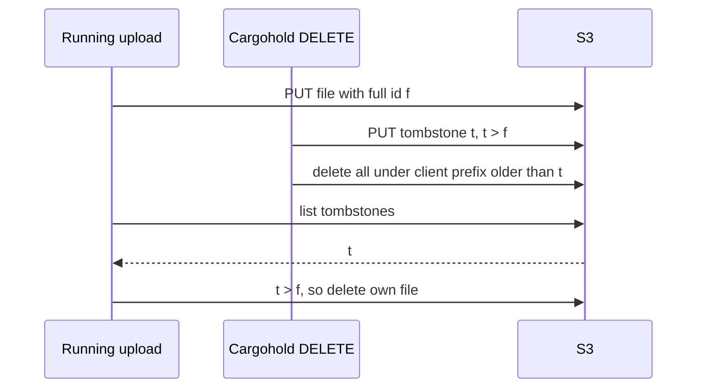
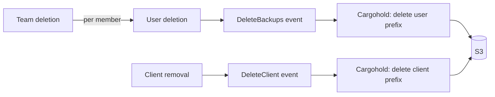

## API endpoints

Only public endpoints are described here. They are grouped by path. `<type>`
marks a value of that type (see [Types](#types)); the examples show filled-in values.

All routes are authenticated via an access token in the header: `Authorization:
Bearer <AccessToken>`. nginz extracts and sets the internal `Z-User`
(`<UserId>`) and `Z-Client` (`<ClientId>`) headers from the token. Clients
don't (and cannot) provide those.

Backup routes exist starting from the development API version, which is `V19`
at the time of writing (this may change due to deferred finishing/merging of
this feature). I.e. all described `/backups/*` endpoints need a `/v19` (or
later) prefix in their path: `/v19/backups/...`.

### Types

This table describes the `<type>` placeholders used in described HTTP routes
(paths) and payloads.

| Type               | JSON / URL form                                                                                          | Example                                |
| ------------------ | -------------------------------------------------------------------------------------------------------- | -------------------------------------- |
| `<ClientId>`       | as in the rest of the Wire API (64-bit hex numeral)                                                      | `4b2f7a9c1d3e5f60`                     |
| `<UserId>`         | as in the rest of the Wire API (UUID)                                                                    | `9c1e7a52-3d84-4b6f-8e0a-71f2c5d9b3a4` |
| `<BackupEpoch>`    | integer 1…4294967295 (0 is rejected with a 400 from the path parser)                                     | `2`                                    |
| `<BackupFileId>`   | UUID (v7, assigned by the server; its time part is `createdAt`)                                          | `01a1cf41-5e4b-7c3b-8d2a-5e6f4a1b9c07` |
| `<FullId>`         | `<BackupFileId>`. The id of a full file is its `<FullId>`: the `id` of a finished full upload            | `01a1cf41-5e4b-7c3b-8d2a-5e6f4a1b9c07` |
| `<TeamId>`         | as in the rest of the Wire API (UUID)                                                                    | `3f0c6d1a-9b7e-4c25-a1d8-6e2b5f4a7c90` |
| `<UTCTimeMillis>`  | ISO 8601 UTC with milliseconds                                                                           | `2026-11-12T10:15:30.123Z`             |
| `<ByteCount>`      | number of bytes, non-negative integer                                                                    | `1048576`                              |
| `<BackupFile>`     | `{"id": <BackupFileId>, "size": <ByteCount>, "createdAt": <UTCTimeMillis>}`                              | see below                              |
| `<BackupFiles>`    | `{"full": <BackupFile>, "incrementals": [<BackupFile>]}`                                                 | see `GET …/epochs/<BackupEpoch>`       |
| `<EpochSummary>`   | `{"epoch": <BackupEpoch>, "createdAt": <UTCTimeMillis>, "fileCount": <Word32>, "size": <ByteCount>}`     | see `GET /backups`                     |
| `<ClientBackups>`  | `{"client": <ClientId>, "epochs": [<EpochSummary>]}`                                                     | see `GET /backups`                     |
| `<BackupSchedule>` | `daily`, `weekly` or `monthly`                                                                           | `weekly`                               |
| `<FeatureStatus>`  | `enabled` or `disabled`                                                                                  | `enabled`                              |
| `<LockStatus>`     | `locked` or `unlocked`                                                                                   | `unlocked`                             |
| `<Bool>`           | `true` or `false`                                                                                        | `false`                                |
| `<Word32>`         | integer 0…4294967295                                                                                     | `12`                                   |
| `<Url>`            | absolute URL                                                                                             | `https://s3.example.com/backup/…`      |
| `<AccessToken>`    | as in the rest of the Wire API (bearer access token)                                                     | `eyJ…`                                 |
| `<FeatureTTL>`     | as in the rest of the Wire API: `"unlimited"` or a number of seconds                                     | `"unlimited"`                          |

---

### `/backups/…`

Rules shared by all routes under `/backups`:

- If the server has no HMAC key configured (backups not configured), every route under `/backups` answers 403 `backup-feature-disabled`.
- `Z-Client` must be a current client of the caller (checked against brig; the token alone doesn't prove it), else 404 `backup-not-found`.
  - This guards against the case where a client has a valid authorization token, but gets deleted while the token is valid.
- Only uploads check the team flag `automaticBackups`; reads work whatever its state.
  - We don't want to cut users off their existing backups.
- Backups are deleted by the client itself (`DELETE /backups/clients/<ClientId>`), when the client is deleted, and all backups of a user when the user is deleted.

#### Newest full wins

The current full backup of an epoch is the one with the greatest
`<BackupFileId>` (UUIDv7, i.e. server time). An incremental is stored under the
full it extends (`<FullId>` in its path) and counts as current only as long as
that full is the newest one. The client learns a full's id from the response of
the finished upload (or from `GET …/epochs/<BackupEpoch>`), so an incremental
can only extend a full that successfully finished uploading. An incremental of
a replaced full is never listed, whatever the timing of the uploads. It stays
in storage until the next upload (full or incremental) to the same epoch
finishes and deletes it.

#### `/backups`

##### `GET /backups`

- **Headers:** `Z-User`, `Z-Client`
- **Request body:** none
- **Response:** 200 `{"clients": [<ClientBackups>]}`

List the restorable backups of all clients of the caller; e.g. to provide an
overview for a new client that restores a backup.

Shows per client its epochs (ascending), per epoch a summary of the current
files. The epoch's contents are:

- `createdAt`: the creation time of the newest current file
- `fileCount`: the number of current files including the full
- `size`: their total bytes.

The summary is small whatever the number of files: Listing all files as well
could easily lead to huge payloads. Thus, we provide only a summary of the
epochs here.

Epochs without a full and clients without any epoch are omitted. (Epochs
without a full can only exist due to technical corner cases, they have no
meaning to clients and users.)

Clients are ordered by `createdAt`, newest first.

To restore, the client picks an entry, lists its files with `GET
/backups/clients/<ClientId>/epochs/<BackupEpoch>` and fetches each via the
download route.

Example: `GET /v19/backups` → `200`

```json
{
  "clients": [
    {
      "client": "4b2f7a9c1d3e5f60",
      "epochs": [
        {
          "epoch": 2,
          "createdAt": "2026-11-12T10:35:30.456Z",
          "fileCount": 2,
          "size": 1050624
        }
      ]
    }
  ]
}
```

---

#### `/backups/clients/<ClientId>/…`

Rules shared by all routes under `/backups/clients/<ClientId>`:

- `Z-Client` and `<ClientId>` must both be clients of the caller, else 404 `backup-not-found`.
- Read routes (GET):
  - A client may read the backups of any client of the same user.
- Write routes (POST):
  - `<ClientId>` must equal `Z-Client` (else 403 `backup-forbidden`). I.e.
  clients can only write for their own, never for others!
  - A stored file is always complete: the object only becomes visible once its
  upload finished. A failed upload leaves no file.
  - Epoch rule (epochs ≥ 1): with no epoch stored any epoch is allowed;
  otherwise only the newest stored epoch `N` or `N+1` (violations raise HTTP 409
  `backup-epoch-not-allowed`).
  - A failed upload (fewer bytes than `Content-Length` arrive, client
  disconnect, storage error, client removed meanwhile) removes the file and
  surfaces the error; a short body or disconnect gives 400 `incomplete-body`.
  - **Size subtlety:** the server stores exactly the first `Content-Length` bytes
  and ignores any excess, because the HTTP layer hands the handler no more than
  that. Too many bytes can't be detected and give a successful upload of a
  truncated file; too few give 400 `incomplete-body`. The response `size` is
  the number of bytes stored, so clients should compare it with the number of
  bytes they sent and, if it differs, upload a new full (for a full) or the
  incremental again as a new file or a new full (for an incremental).

##### `/backups/clients/<ClientId>`

###### `GET /backups/clients/<ClientId>`

- **Headers:** `Z-User`, `Z-Client`
- **Request body:** none
- **Response:** 200 `<ClientBackups>`

The restorable epochs of one client, as one entry of `GET /backups`. `"epochs":
[]` if the client has no restorable backup.

Example: `GET /v19/backups/clients/4b2f7a9c1d3e5f60` → `200`

```json
{
  "client": "4b2f7a9c1d3e5f60",
  "epochs": [
    {
      "epoch": 2,
      "createdAt": "2026-11-12T10:35:30.456Z",
      "fileCount": 2,
      "size": 1050624
    }
  ]
}
```

###### `DELETE /backups/clients/<ClientId>`

- **Headers:** `Z-User`, `Z-Client`
- **Request body:** none
- **Response:** 204, empty body

Delete all backups of the client. `<ClientId>` must equal `Z-Client` (403
`backup-forbidden` otherwise). The team flag `automaticBackups` is not checked, so
a client can clean up while the feature is disabled. It succeeds if there is nothing to delete.

Uploads that are still running when this is called are rejected (403 `backup-forbidden`) and
leave no file behind. The same goes for incrementals under a full from before the call.

Fulls that start uploading after the call are kept, together with their incrementals, so they
create backups again. The client should therefore stop scheduling uploads before it calls this.

Example: `DELETE /v19/backups/clients/4b2f7a9c1d3e5f60` → `204`

---

##### `/backups/clients/<ClientId>/epochs/<BackupEpoch>`

###### `GET /backups/clients/<ClientId>/epochs/<BackupEpoch>`

- **Headers:** `Z-User`, `Z-Client`
- **Request body:** none
- **Response:** 200 `<BackupFiles>`: the current full and the incrementals under it, by `id`.

List the current files of an epoch (metadata only, no URLs). `full.id` is the
`<FullId>` in the paths of the upload and download routes of all of these
files. 404 `backup-not-found` if the epoch has no full.

Example: `GET /v19/backups/clients/4b2f7a9c1d3e5f60/epochs/2` → `200`

```json
{
  "full": {
    "id": "01a1cf41-5e4b-7c3b-8d2a-5e6f4a1b9c07",
    "size": 1048576,
    "createdAt": "2026-11-12T10:15:30.123Z"
  },
  "incrementals": [
    {
      "id": "01a1cf53-af18-7e55-9f10-2c3d4e5f6a7b",
      "size": 2048,
      "createdAt": "2026-11-12T10:35:30.456Z"
    }
  ]
}
```

---

##### `/backups/clients/<ClientId>/epochs/<BackupEpoch>/full`

###### `POST /backups/clients/<ClientId>/epochs/<BackupEpoch>/full`

- **Headers:** `Z-User`, `Z-Client`, `Content-Length: <ByteCount>`, `Content-Type: application/octet-stream`
- **Request body:** raw backup bytes (`Content-Length` ≤ `maxFullBytes`)
- **Response:** 200 `<BackupFile>`, `"size"` = number of bytes stored. Its `id` is the `<FullId>` of the incrementals that extend this full

Upload the full file of an epoch. It replaces the previous full of the epoch
and the incrementals of it.

Checked before any write, in this order: own client, team flag
`automaticBackups` enabled (user has a team), epoch rule, `Content-Length` over
the cap (raises HTTP 413).

The server keeps at most the two newest epochs of a client: after a full file
is stored it deletes all files of every epoch except the two newest, i.e. the
oldest one when a third epoch starts. Storing an incremental file deletes no
epochs.

After storing, the server lists the epoch and deletes everything the new full
superseded: older fulls (according to the mentioned rule) and all incrementals
stored under them. Concurrent full uploads delete each other; the newest wins.
A late older one deletes itself but still responds 200 with its `id`; an
incremental upload under that id then gets 409 `backup-full-missing`. Example:
full A starts (slow), full B starts later and finishes first; when A finishes,
B is newer, so A deletes itself.

Example: `POST /v19/backups/clients/4b2f7a9c1d3e5f60/epochs/2/full` with
`Content-Length: 1048576` and 1048576 body bytes → `200`

```json
{
  "id": "01a1cf41-5e4b-7c3b-8d2a-5e6f4a1b9c07",
  "size": 1048576,
  "createdAt": "2026-11-12T10:15:30.123Z"
}
```

---

##### `/backups/clients/<ClientId>/epochs/<BackupEpoch>/full/<FullId>/incremental`

###### `POST /backups/clients/<ClientId>/epochs/<BackupEpoch>/full/<FullId>/incremental`

- **Headers:** `Z-User`, `Z-Client`, `Content-Length: <ByteCount>`, `Content-Type: application/octet-stream`
- **Request body:** raw backup bytes (`Content-Length` ≤ `maxIncrementalBytes`)
- **Response:** 200 `<BackupFile>`

Upload an incremental file under the full `<FullId>`, which must be the epoch's
current full. If no full exists you get 409 `backup-full-missing`, meaning
there's no such full or it was replaced. If there's no such full, upload a new
one; if it was replaced, refer to the current one.

These rules apply: size cap (HTTP 413) and file count cap `maxFilesPerEpoch`
counting the current files including the full (409 `backup-too-many-files`).
Concurrent incrementals can slightly exceed the file amount cap.

Example: `POST /v19/backups/clients/4b2f7a9c1d3e5f60/epochs/2/full/01a1cf41-5e4b-7c3b-8d2a-5e6f4a1b9c07/incremental` with `Content-Length: 2048` and 2048 body bytes → `200`

```json
{
  "id": "01a1cf53-af18-7e55-9f10-2c3d4e5f6a7b",
  "size": 2048,
  "createdAt": "2026-11-12T10:35:30.456Z"
}
```

---

##### `/backups/clients/<ClientId>/epochs/<BackupEpoch>/full/<FullId>`

###### `GET /backups/clients/<ClientId>/epochs/<BackupEpoch>/full/<FullId>`

- **Headers:** `Z-User`, `Z-Client`
- **Request body:** none
- **Response:** 302, empty body, `Location: <Url>` (presigned S3 URL, bearer link valid for `downloadLinkTTL` seconds)

Download the full file via redirect. 404 `backup-not-found` if no such file
exists (e.g. it was replaced by a newer full).

Example: `GET /v19/backups/clients/4b2f7a9c1d3e5f60/epochs/2/full/01a1cf41-5e4b-7c3b-8d2a-5e6f4a1b9c07` → `302`, `Location: https://s3.example.com/backup/…?X-Amz-Signature=…`

---

##### `/backups/clients/<ClientId>/epochs/<BackupEpoch>/full/<FullId>/incremental/<BackupFileId>`

###### `GET /backups/clients/<ClientId>/epochs/<BackupEpoch>/full/<FullId>/incremental/<BackupFileId>`

- **Headers:** `Z-User`, `Z-Client`
- **Request body:** none
- **Response:** 302, empty body, `Location: <Url>` (as above)

Download an incremental file via redirect. 404 `backup-not-found` if no such
file exists under that full.

Example: `GET /v19/backups/clients/4b2f7a9c1d3e5f60/epochs/2/full/01a1cf41-5e4b-7c3b-8d2a-5e6f4a1b9c07/incremental/01a1cf53-af18-7e55-9f10-2c3d4e5f6a7b` → `302`, `Location: https://s3.example.com/backup/…?X-Amz-Signature=…`

---

### `/teams/<TeamId>/features/automaticBackups`

Generic team feature API. Feature routes are not version bound and can be
accessed with any version prefix (e.g. `/v{n}/teams/...`). `<ConfigBody>` is `{"enforcedSchedule": <BackupSchedule>, "enforced": <Bool>, "serverOnly": <Bool>}`.

Defaults:

- `status`: `disabled`
- `lockStatus`: `unlocked`
- `enforcedSchedule`: `weekly`
- `enforced`: `false`
- `serverOnly`: `false` (Not checked by the server: tells clients to store backups on the server only, not locally.)

#### `GET /teams/<TeamId>/features/automaticBackups`

- **Headers:** `Z-User`
- **Request body:** none
- **Response:** 200 `{"status": <FeatureStatus>, "lockStatus": <LockStatus>, "config": <ConfigBody>, "ttl": "unlimited"}`

Read the team feature config. Caller must be a team member.

Example: `GET /v19/teams/3f0c6d1a-9b7e-4c25-a1d8-6e2b5f4a7c90/features/automaticBackups` → `200`

```json
{
  "status": "enabled",
  "lockStatus": "unlocked",
  "config": {
    "enforcedSchedule": "daily",
    "enforced": false,
    "serverOnly": false
  },
  "ttl": "unlimited"
}
```

#### `PUT /teams/<TeamId>/features/automaticBackups`

- **Headers:** `Z-User`, `Content-Type: application/json`
- **Request body:** `{"status": <FeatureStatus>, "config": <ConfigBody>, "ttl": <FeatureTTL>}`. `ttl` is optional (`"unlimited"`, `"0"` or positive integer).
- **Response:** 200, same body as `GET`

Set the team feature config. Needs the permission to change team features. 409
`feature-locked` if `lockStatus` is `locked`. `ttl` (*T*ime *T*o *L*ive) is
ignored; the response always has `"ttl": "unlimited"`.

Example: `PUT /v19/teams/3f0c6d1a-9b7e-4c25-a1d8-6e2b5f4a7c90/features/automaticBackups`

```json
{
  "status": "enabled",
  "config": {
    "enforcedSchedule": "daily",
    "enforced": false,
    "serverOnly": false
  }
}
```

→ `200`

```json
{
  "status": "enabled",
  "lockStatus": "unlocked",
  "config": {
    "enforcedSchedule": "daily",
    "enforced": false,
    "serverOnly": false
  },
  "ttl": "unlimited"
}
```

---

### Errors

| Status | Label                                | Raised by                                                                                                                                                                                                                                                                                                                                                                                      |
| ------ | ------------------------------------ | ---------------------------------------------------------------------------------------------------------------------------------------------------------------------------------------------------------------------------------------------------------------------------------------------------------------------------------------------------------------------------------------------- |
| 400    | `incomplete-body`                    | `POST …/full`, `POST …/incremental` (fewer bytes than `Content-Length` arrive, or disconnect)                                                                                                                                                                                                                                                                                                  |
| 403    | `backup-feature-disabled`            | `POST …/full`, `POST …/incremental` (team flag not enabled, or user has no team);<br>every `/backups` route (backups not configured on the server, i.e. no HMAC key)                                                                                                                                                                                                                           |
| 403    | `backup-forbidden`                   | `POST …/full`, `POST …/incremental` (`<ClientId>` is not `Z-Client`; the client was removed<br>or its backups were deleted during the upload);<br>`DELETE /backups/clients/<ClientId>` (`<ClientId>` is not `Z-Client`)                                                                                                                                                                        |
| 403    | `operation-denied`, `no-team-member` | `GET`, `PUT /teams/<TeamId>/features/automaticBackups`                                                                                                                                                                                                                                                                                                                                         |
| 404    | `backup-not-found`                   | `GET /backups` (`Z-Client` is not a client of the caller);<br>`GET /backups/clients/<ClientId>`, `GET …/epochs/<BackupEpoch>`,<br>`GET …/full/<FullId>[/incremental/<BackupFileId>]` (`Z-Client` or `<ClientId>` is not a client<br>of the caller; for the last two also no such epoch or file);<br>`POST`s, `DELETE /backups/clients/<ClientId>` (`<ClientId>` is not a client of the caller) |
| 404    | `no-team`                            | `GET`, `PUT /teams/<TeamId>/features/automaticBackups`                                                                                                                                                                                                                                                                                                                                         |
| 409    | `backup-epoch-not-allowed`           | `POST …/full`, `POST …/incremental`                                                                                                                                                                                                                                                                                                                                                            |
| 409    | `backup-full-missing`                | `POST …/full/<FullId>/incremental` (no full `<FullId>`, or not the current one)                                                                                                                                                                                                                                                                                                                |
| 409    | `backup-too-many-files`              | `POST …/incremental`                                                                                                                                                                                                                                                                                                                                                                           |
| 409    | `feature-locked`                     | `PUT /teams/<TeamId>/features/automaticBackups`                                                                                                                                                                                                                                                                                                                                                |
| 413    | `backup-too-large`                   | `POST …/full`, `POST …/incremental` (declared `Content-Length` over the cap;<br>checked on the declared value, before any byte is read)                                                                                                                                                                                                                                                        |

## Storage

Wire-server already uses S3 storage to store assets. Thus there are some
synergies in storing the backups via S3 as well. Architecturally, the Cargohold
service owns S3. Sticking to S3 has the nice benefit that we do not have to
manually maintain state in a database and keep the configuration effort for
administrators low. This design embraces this idea: backups live in S3 (the
asset bucket) and nowhere else. Cargohold needs no database for them.

### S3 Structure

We encode metadata in S3 object keys (“paths”). This provides easy lookups,
some structure in case debugging is required and avoids additional costs for
tags.

#### Key layout

The key layout is:

- `backup/<h(uid)>/<h(cid)>/<epoch>/<fullId>/full`: Full backup object (“file”)
- `backup/<h(uid)>/<h(cid)>/<epoch>/<fullId>/incremental/<id>`: Incremental backup object (“file”), stored under the full it extends
- `backup/<h(uid)>/<h(cid)>/.tombstones/<id>`: Empty tombstone object written by the client's own
  backup deletion (see [Deletion and upload ordering](#deletion-and-upload-ordering)). It is not
  an epoch, so listings ignore it.

`uid` and `cid` are userId and clientId respectively. `h()` obfuscates them with
an HMAC (see [Obfuscated ids (HMAC)](#obfuscated-ids-hmac)).

`fullId` and incrementals' `id` are UUIDv7s. Each is unique per upload and
generated by the server on upload requests. Their time part gives `createdAt`
for API responses, so no timestamp is stored. `epoch` is a decimal number ≥ 1
without padding; analogous to the API representation of epochs.

The general path structure is: userId → clientId → epoch → full → incrementals:

- Encoding userId and clientId allows easy lookup and authorization based on these parameters
- The epoch part enables easy lookup based on it as well
- The `fullId` segment ties an incremental to the full it extends. There is no
  ambiguity which full an incremental belongs to, and a replaced full and its
  incrementals are identified (and deleted) by the same prefix.

`backup/` is outside the asset prefixes (`v3/<retention>/`), so asset lifecycle
rules should never expire backups. **The operator must ensure that no
conflicting rules are applied to the whole bucket or affecting this prefix path
in any way!**

#### Metadata

Metadata comes from the key and the S3 listing only (`ListObjectsV2` returns
key, size and `LastModified`, but never user metadata or tags):

| API field                                 | Source                                                |
| ----------------------------------------- | ----------------------------------------------------- |
| epochs of a client                        | `CommonPrefixes` of the client prefix (delimiter `/`) |
| `id`, `fullId`, kind (full / incremental) | key segments                                          |
| `size`                                    | listing `Size`                                        |
| `createdAt`                               | UUIDv7 timestamp                                      |

Object metadata (`x-amz-meta-*`) is not used as it is immutable, needs a HEAD
per object and is returned as response headers to the holder of a presigned
URL. Object tags are not used as they would require one extra call per object
and are unevenly supported in S3-compatible stores. Additionally, tags cost
money on AWS.

Keys that do not parse (non-canonical epoch, unknown kind, invalid UUID) are
ignored in listings and are not addressable by design.

#### Obfuscated ids (HMAC)

All keys that relate to personal information are obfuscated by applying HMAC to
them, as indicated by the `h()` function: lowercase hex of HMAC-SHA256 (64
characters) over the textual id, keyed with the secret `backupHmacKey` (at
least 32 bytes). The secret is part of Cargohold’s configuration (Helm:
`cargohold.secrets.backupHmacKey`). If it is missing, backups are not
configured: the server answers all `/backups` routes with HTTP 403
`backup-feature-disabled`, and the internal deletes (client or user deletion in
brig) succeed as no-ops. Actually, we've got no other choice: Without correct
hashes, objects cannot be addressed.

A key that is set but shorter than 32 bytes or unreadable makes Cargohold
refuse to start. This is to avoid cryptographically weak hashes.
HMAC is one-way: every operation starts from a known user and client id.
Changing or losing the secret makes all existing backups unreachable and
undeletable via the API.

Presigned download URLs reveal `h(uid)` and `h(cid)` only: they link
downloads of the same client, nothing more.

Key rotation is left to be planned and implemented in the future, if required. This
could involve a two-step process, first using the old key to then re-encode
paths with the new one. For now, as this is about obfuscation of relationships
and not encryption, we consider sticking with one HMAC secret as good enough.

#### Epochs and files

Constraints on epochs and files are:

- A current epoch has exactly one current full and N incrementals under it.
- Epoch rule: epochs are ≥ 1. With highest existing epoch N, uploads go to N or N+1.
- Only the two newest epochs of a client are kept (pruned after each full upload).
- At most `maxFilesPerEpoch` current files per epoch including the full
  (concurrent incrementals can exceed it slightly). Size
  caps: `maxFullBytes` (a full, default 1 GiB) and `maxIncrementalBytes` (an
  incremental, default 10 MiB). All three are Cargohold settings
  (`settings.backupLimits`).

### Concurrency without locks

Uploads are lock-free and safe against races:

- An S3 object becomes visible only when its upload completed (uploads are
  streamed as S3 multipart uploads and completed at the end). A stored file is
  therefore always complete. There is no lockfile and no readiness flag.
- No TTL or staleness handling is needed. Clients that are unsure about a full
  upload can repeat it: the newest full wins.
- The current full of an epoch is the one with the greatest `fullId`.
  Incrementals under any other full are superseded: never listed, but
  downloadable until pruned (only by the same client).
- An incremental needs the current full, else uploading gets HTTP 409
  `backup-full-missing`.
- After storing any file (full or incremental), the server lists the epoch and
  deletes everything the current full superseded: older fulls and incrementals
  not stored under the current full. For an incremental upload this removes the
  orphan of an upload that raced a newer full. Example: incremental I starts
  under full F1; full F2 finishes while I uploads and prunes F1 (I is not
  visible yet); when I finishes, F2 is current, so I's own prune deletes I.
- After storing a full file (not an incremental), the server also deletes all
  files of all but the two newest epochs. The epochs are listed after the
  store, so epochs that other uploads created meanwhile count.
- A failed upload (storage error, short body, disconnect, client removed or its
  backups deleted by the client meanwhile) deletes the object it created.
- After the PUT, the server re-checks that the client still exists and deletes
  the object if not. Brig deletes the backups only after the client row is
  gone, so a client deletion racing an upload leaves no orphan (see "Deletion and upload
  ordering").

The clear relation between fulls and incrementals (see "Newest full wins")
prevents a couple of difficult issues:

- Incrementals can never be accounted to a wrong full. (This would render the backup useless!)
- Race conditions on server-side regarding
  - lock creation
  - crashes

"Newest full wins" and tombstones rely on UUIDv7 time order across Cargohold
instances, so their clocks must be roughly synchronized (NTP is enough).

### Deletion and versioned buckets

As per GDPR laws, the deletion of personal data must be complete and
unrestorable on a user's behalf. Accordingly, versioned AWS buckets need
special treatment to ensure that _all related data_ gets wiped.
Also for security reasons, backups of a removed client must be deleted
immediately.

Deletes of a client’s or user’s backups, of superseded files and of stale
epochs remove **all versions** of the affected keys. On a versioned bucket a
plain delete only adds a delete marker and the encrypted data would stay
restorable. To deal with this, Cargohold lists all versions and delete markers
under the key prefix (`ListObjectVersions`) and deletes each `VersionId`
explicitly via `DeleteObjects` (batches of at most 1000). Unversioned buckets
report version id `null` and take the same path. If the store answers
`NotImplemented` for `ListObjectVersions`, Cargohold falls back to
`ListObjectsV2` plus plain deletes. Bucket versioning may therefore be on or
off.

### Deletion and upload ordering

The client removal request never directly touches Cargohold (clients can be
removed for security reasons, so a failing Cargohold must not affect it): Brig
enqueues the deletion as event and then deletes the client row (a failing
enqueue leaves the client in place, so the removal can be retried). The
consumer of that queue deletes the client row again (idempotent) and then the client's backups
(Cargohold, by prefix), and is retried until that succeeds.

Uploads and removals are ordered so that no backup outlives its client. The
client row is always deleted before the backups. An upload first PUTs the
object and then asks brig whether the client still exists; if not, it deletes
the object again and fails. So for any upload overlapping a removal, either the
prefix deletion lists the object, or the re-check sees the client gone and the
upload process deletes its object.

Deleting the backups on request of the client (`DELETE /backups/clients/<ClientId>`) has no
client row to order against, so it uses tombstones. It first stores a tombstone
(`.tombstones/<id>`, a UUIDv7 like file ids), then deletes everything under the client prefix
that is older than the tombstone (one sweep): tombstones by their id, files by their `<FullId>`
(an incremental belongs to its full). After its PUT and the client check, an upload lists the
tombstones: one newer than the file's `<FullId>` means the deletion removes the file, so the
upload deletes its object and fails with 403 `backup-forbidden`. Either the deletion lists the
object, or the upload sees the tombstone. Fulls started after the deletion, and their
incrementals, are newer and kept. Keeping newer tombstones means an older concurrent deletion
cannot erase the tombstone of a newer one. This relies on UUIDv7 time order across
Cargohold instances, like "Newest full wins". Client and user deletion remove tombstones with
the prefix.

User deletion will work the same way, with a *new* backend-internal queue event
(`DeleteBackups`, not a Wire event, never fanned out). Brig's `deleteAccount`
enqueues it first, before the user is marked deleted, so a failing enqueue
leaves the deletion retriable. The consumer deletes the user's client rows
(idempotent) and then all backups of the user (Cargohold, by prefix), and is
retried until that succeeds.

## Use cases

The backend-related use cases of the RFC "Secure Automatic Backups" and how they map to this
design. Each use case lists:

- **Public endpoints:** the routes the client calls (or the generic Wire flow that triggers it)
- **Internal:** calls between services and queue events
- **S3:** objects that are created, deleted or read (see [Key layout](#key-layout))

A variant of another use case only states its difference.

### 1. Automatic backup upload

RFC: "Wire server", "Encrypting a backup file". A device uploads a full or incremental file of
its current epoch.

- **Public endpoints:**
  - `POST /backups/clients/<ClientId>/epochs/<BackupEpoch>/full`
  - `POST /backups/clients/<ClientId>/epochs/<BackupEpoch>/full/<FullId>/incremental`
  - optionally `GET /backups/clients/<ClientId>` to learn the stored epochs
- **Internal:**
  - Cargohold → Brig: the client exists, before the upload and again after the PUT
  - Cargohold → Galley: team flag `automaticBackups` is enabled
- **S3:**
  - PUT `backup/<h(uid)>/<h(cid)>/<epoch>/<fullId>/full` or
    `backup/<h(uid)>/<h(cid)>/<epoch>/<fullId>/incremental/<id>`
  - deletes all versions under `backup/<h(uid)>/<h(cid)>/<epoch>/<fullId>/` of every superseded
    full
  - lists `backup/<h(uid)>/<h(cid)>/.tombstones/`
  - a failed upload deletes its own object

Note: the RFC allows only epoch 1 if no epoch is stored; here any epoch ≥ 1 is allowed.

### 2. New backup epoch

RFC: "Restoring from a remote backup", "Encrypting a backup file". After sharing its BEK the
device increments its epoch and uploads a new full.

- **Public endpoints:** `POST /backups/clients/<ClientId>/epochs/<BackupEpoch>/full` (epoch N+1)
- **Internal:** as in [1](#1-automatic-backup-upload)
- **S3:** PUT `backup/<h(uid)>/<h(cid)>/<epoch>/<fullId>/full`, then deletes all versions under
  `backup/<h(uid)>/<h(cid)>/<epoch>/` of every epoch but the two newest

Note: in the RFC the client deletes its epochs ≤ `epoch - 2` before the first upload of an epoch.
Here the server prunes after storing a full, so the client needs no delete call. With epochs N
and N+1 stored the RFC allows only N+1; here N+2 is allowed too and its full prunes N.

### 3. Restore from a remote backup

RFC: "Restoring from a remote backup". Device A restores an epoch of device B of the same user,
with the BEK that B shared via MLS.

- **Public endpoints:**
  - `GET /backups` (overview of all clients) or `GET /backups/clients/<ClientId>`
  - `GET /backups/clients/<ClientId>/epochs/<BackupEpoch>`
  - `GET /backups/clients/<ClientId>/epochs/<BackupEpoch>/full/<FullId>` and
    `GET /backups/clients/<ClientId>/epochs/<BackupEpoch>/full/<FullId>/incremental/<BackupFileId>`:
    302 to a presigned URL
- **Internal:** Cargohold → Brig: A and B are clients of the caller
- **S3:** read only. Lists `backup/<h(uid)>/<h(cid)>/` (epochs) and
  `backup/<h(uid)>/<h(cid)>/<epoch>/`, presigned GET of
  `backup/<h(uid)>/<h(cid)>/<epoch>/<fullId>/full` and
  `backup/<h(uid)>/<h(cid)>/<epoch>/<fullId>/incremental/<id>`

Note: the team flag is not checked on reads.

### 4. Restore after losing the only device

RFC: "Overview", scenario 2. Like [3](#3-restore-from-a-remote-backup), except: the BEK is derived from the imported RootBEK, not
shared by another device. It only works while the lost client is still registered: removing it
([7](#7-device-removed-or-compromised)) deletes its backups. So restore first, then remove the lost device.

### 5. Device deletes its backups

RFC: "Backups under user control", "Backups under team administrator control". The user
disables backups on the device, or the admin lifts the enforcement and backups are disabled on
the device.

- **Public endpoints:** `DELETE /backups/clients/<ClientId>` (own client only)
- **Internal:** Cargohold → Brig: the client exists
- **S3:**
  - PUT `backup/<h(uid)>/<h(cid)>/.tombstones/<id>`
  - deletes all versions under `backup/<h(uid)>/<h(cid)>/` that are older than its own
    tombstone: tombstones `backup/<h(uid)>/<h(cid)>/.tombstones/<id>` by `<id>`, files by
    `<FullId>`
  - uploads that were running delete their object (see
    [Deletion and upload ordering](#deletion-and-upload-ordering))



Either the deletion lists the file, or the upload sees the tombstone.

### 6. Device enables backups again

RFC: "Backups under user control". Like [1](#1-automatic-backup-upload), except: the device has a new RootBEK and starts at
epoch 1 again. After [5](#5-device-deletes-its-backups) no epoch is stored (tombstones are no epochs), so epoch 1 is allowed. The
remaining tombstone `backup/<h(uid)>/<h(cid)>/.tombstones/<id>` is older than the new upload and
does not reject it. The upload need not wait for the response of the deletion: its full is newer
than the tombstone, so the deletion keeps it.

### 7. Device removed or compromised

RFC: "Backup deletion", "Device compromise". The user removes a device.

- **Public endpoints:** the existing client removal, `DELETE /clients/<ClientId>`
- **Internal:**
  - Brig enqueues `DeleteClient`, then deletes the client row
  - the queue consumer deletes the row again, then calls Cargohold
    `DELETE /i/backups/users/<UserId>/clients/<ClientId>`, retried until it succeeds
- **S3:** deletes all versions under `backup/<h(uid)>/<h(cid)>/`, tombstones included

Note: the RFC requires immediate deletion. Here it is asynchronous via the queue, but reads need
a current client, so the backups are unreachable as soon as the client row is gone.

### 8. User deleted

RFC: "Backup deletion".

- **Public endpoints:** the generic user deletion
- **Internal:**
  - Brig's `deleteAccount` enqueues `DeleteBackups` first
  - the queue consumer deletes the user's client rows, then calls Cargohold
    `DELETE /i/backups/users/<UserId>`, retried until it succeeds
- **S3:** deletes all versions under `backup/<h(uid)>/`

### 9. Team deleted

RFC: "Backup deletion". Like [8](#8-user-deleted), except: triggered by the generic team deletion. Galley deletes
each team member via Brig, which runs [8](#8-user-deleted) per member.



