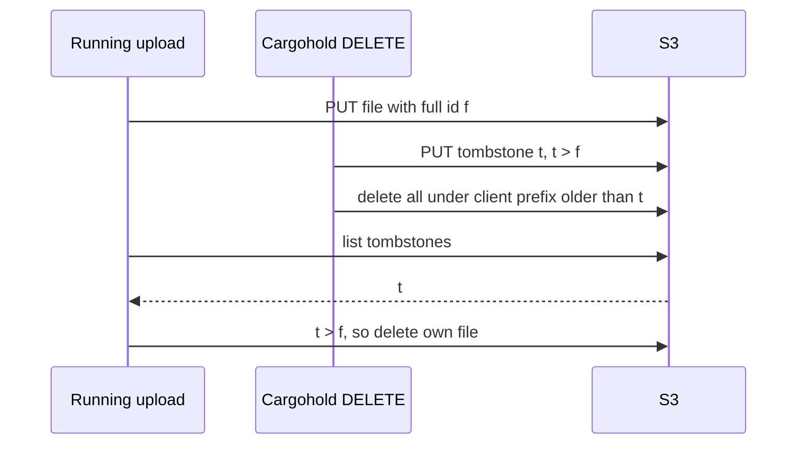
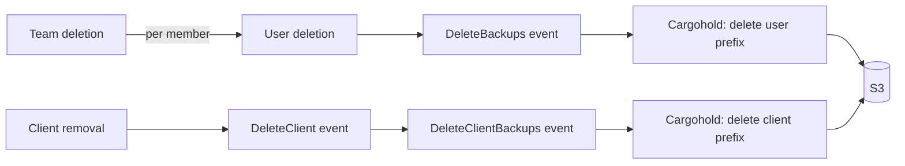

## API endpoints

Only public endpoints are described here. They are grouped by path. `<type>`
marks a value of that type (see [Types](#types)); the examples show filled-in values.

All routes are authenticated via an access token in the header: `Authorization:
Bearer <AccessToken>`. nginz extracts and sets the internal `Z-User`
(`<UserId>`) and `Z-Client` (`<ClientId>`) headers from the token. Clients
don't (and cannot) provide those.

Backup routes exist starting from the development API version, which is `V19`
at the time of writing (this may change due to deferred finishing/merging of
this feature). I.e. all described `/backups/*` endpoints need a `/v19` (or
later) prefix in their path: `/v19/backups/...`.

### Types

This table describes the `<type>` placeholders used in described HTTP routes
(paths) and payloads.

| Type               | JSON / URL form                                                                                      | Example                                |
| ------------------ | ---------------------------------------------------------------------------------------------------- | -------------------------------------- |
| `<ClientId>`       | as in the rest of the Wire API (64-bit hex numeral)                                                  | `4b2f7a9c1d3e5f60`                     |
| `<UserId>`         | as in the rest of the Wire API (UUID)                                                                | `9c1e7a52-3d84-4b6f-8e0a-71f2c5d9b3a4` |
| `<BackupEpoch>`    | integer 1...4294967295 (0 is rejected with a 400 from the path parser)                               | `2`                                    |
| `<BackupFileId>`   | UUID (v7, assigned by the server; its time part is `createdAt`)                                      | `01a1cf41-5e4b-7c3b-8d2a-5e6f4a1b9c07` |
| `<FullId>`         | `<BackupFileId>`. The id of a full file is its `<FullId>`: the `id` of a finished full upload        | `01a1cf41-5e4b-7c3b-8d2a-5e6f4a1b9c07` |
| `<TeamId>`         | as in the rest of the Wire API (UUID)                                                                | `3f0c6d1a-9b7e-4c25-a1d8-6e2b5f4a7c90` |
| `<UTCTimeMillis>`  | ISO 8601 UTC with milliseconds                                                                       | `2026-11-12T10:15:30.123Z`             |
| `<ByteCount>`      | number of bytes, non-negative integer                                                                | `1048576`                              |
| `<BackupFile>`     | `{"id": <BackupFileId>, "size": <ByteCount>, "createdAt": <UTCTimeMillis>}`                          | see below                              |
| `<BackupFiles>`    | `{"full": <BackupFile>, "incrementals": [<BackupFile>]}`                                             | see `GET .../epochs/<BackupEpoch>`     |
| `<EpochSummary>`   | `{"epoch": <BackupEpoch>, "createdAt": <UTCTimeMillis>, "fileCount": <Word32>, "size": <ByteCount>}` | see `GET /backups`                     |
| `<ClientBackups>`  | `{"client": <ClientId>, "epochs": [<EpochSummary>]}`                                                 | see `GET /backups`                     |
| `<BackupSchedule>` | `daily`, `weekly` or `monthly`                                                                       | `weekly`                               |
| `<FeatureStatus>`  | `enabled` or `disabled`                                                                              | `enabled`                              |
| `<LockStatus>`     | `locked` or `unlocked`                                                                               | `unlocked`                             |
| `<Bool>`           | `true` or `false`                                                                                    | `false`                                |
| `<Word32>`         | integer 0...4294967295                                                                               | `12`                                   |
| `<Url>`            | absolute URL                                                                                         | `https://s3.example.com/backup/...`    |
| `<AccessToken>`    | as in the rest of the Wire API (bearer access token)                                                 | `eyJ...`                               |
| `<FeatureTTL>`     | as in the rest of the Wire API: `"unlimited"` or a number of seconds                                 | `"unlimited"`                          |

---

### `/backups/...`

Rules shared by all routes under `/backups`:

- If the server has no HMAC key configured (backups not configured), every route under `/backups` answers 403 `backup-feature-disabled`.
- `Z-Client` must be a current client of the caller (checked against brig; the token alone doesn't prove it), else 404 `backup-not-found`.
  - This guards against the case where a client has a valid authorization token, but gets deleted while the token is valid.
- Only uploads check the team flag `automaticBackups`; reads work whatever its state.
  - We don't want to cut users off from their existing backups.
- Backups are deleted by the client itself (`DELETE /backups/clients/<ClientId>`), when the client is deleted, and all backups of a user when the user is deleted.

#### Newest full wins

The current full backup of an epoch is the one with the greatest
`<BackupFileId>` (UUIDv7, i.e. server time). An incremental is stored under the
full it extends (`<FullId>` in its path) and counts as current only as long as
that full is the newest one. The client learns a full's id from the response of
the finished upload (or from `GET .../epochs/<BackupEpoch>`), so an incremental
can only extend a full that successfully finished uploading. An incremental of
a replaced full is never listed, whatever the timing of the uploads. Why this
holds under concurrent uploads: see [Safe file management](#safe-file-management).

#### `/backups`

##### `GET /backups`

- **Headers:** `Z-User`, `Z-Client`
- **Request body:** none
- **Response:** 200 `{"clients": [<ClientBackups>]}`

List the restorable backups of all clients of the caller; e.g. to provide an
overview for a new client that restores a backup.

Shows per client its epochs (ascending), per epoch a summary of the current
files. The epoch's contents are:

- `createdAt`: the creation time of the newest current file
- `fileCount`: the number of current files including the full
- `size`: their total bytes.

The summary is small whatever the number of files: Listing all files as well
could easily lead to huge payloads. Thus, we provide only a summary of the
epochs here.

Epochs without a full and clients without any epoch are omitted. (Epochs
without a full can only exist due to a race, see [Special
cases](#special-cases); they have no meaning to clients and users.)

Clients are ordered by `createdAt`, newest first.

To restore, the client picks an entry, lists its files with `GET
/backups/clients/<ClientId>/epochs/<BackupEpoch>` and fetches each via the
download route.

Example: `GET /v19/backups` → `200`

```json
{
  "clients": [
    {
      "client": "4b2f7a9c1d3e5f60",
      "epochs": [
        {
          "epoch": 2,
          "createdAt": "2026-11-12T10:35:30.456Z",
          "fileCount": 2,
          "size": 1050624
        }
      ]
    }
  ]
}
```

---

#### `/backups/clients/<ClientId>/...`

Rules shared by all routes under `/backups/clients/<ClientId>`:

- `Z-Client` and `<ClientId>` must both be clients of the caller, else 404 `backup-not-found`.
- Read routes (GET):
  - A client may read the backups of any client of the same user.
- Write routes (POST):
  - `<ClientId>` must equal `Z-Client` (else 403 `backup-forbidden`). I.e.
    clients can only write for their own, never for others!
  - A stored file is always complete: the object only becomes visible once its
    upload finished. A failed upload leaves no file (except in rare
    infrastructure failures, see [Special cases](#special-cases)).
  - Epoch rule (epochs ≥ 1): with no epoch stored any epoch is allowed;
    otherwise only the newest stored epoch `N` or `N+1` (violations raise HTTP 409
    `backup-epoch-not-allowed`).
  - A failed upload (fewer bytes than `Content-Length` arrive, client
    disconnect, storage error, client removed meanwhile) surfaces the error; a
    short body or disconnect gives 400 `incomplete-body`.
  - An empty file (`Content-Length: 0`) is rejected with 400 `invalid-length`.
  - **Size subtlety:** clients must send exactly `Content-Length` bytes. The
    server stores the first `Content-Length` bytes and can't detect any excess
    (the HTTP layer hands it no more), so too many bytes give a truncated file;
    too few give 400 `incomplete-body`.

##### `/backups/clients/<ClientId>`

###### `GET /backups/clients/<ClientId>`

- **Headers:** `Z-User`, `Z-Client`
- **Request body:** none
- **Response:** 200 `<ClientBackups>`

The restorable epochs of one client, as one entry of `GET /backups`. `"epochs":
[]` if the client has no restorable backup.

Example: `GET /v19/backups/clients/4b2f7a9c1d3e5f60` → `200`

```json
{
  "client": "4b2f7a9c1d3e5f60",
  "epochs": [
    {
      "epoch": 2,
      "createdAt": "2026-11-12T10:35:30.456Z",
      "fileCount": 2,
      "size": 1050624
    }
  ]
}
```

###### `DELETE /backups/clients/<ClientId>`

- **Headers:** `Z-User`, `Z-Client`
- **Request body:** none
- **Response:** 204, empty body

Delete all backups of the client. `<ClientId>` must equal `Z-Client` (403
`backup-forbidden` otherwise). The team flag `automaticBackups` is not checked, so
a client can clean up while the feature is disabled. It succeeds if there is nothing to delete.

The deletion removes every file whose full was created before the call, and keeps every file
whose full was created after it (see [Safe file management](#safe-file-management)). So uploads
still running when this is called leave no file behind; they are rejected (403
`backup-forbidden`). (One finishing at the very moment of the call may still answer 200; its
file is removed all the same.) Fulls started after the call returned (204) are kept, together
with their incrementals, so they create backups again. The client should therefore stop
scheduling uploads before it calls this endpoint.

Example: `DELETE /v19/backups/clients/4b2f7a9c1d3e5f60` → `204`

---

##### `/backups/clients/<ClientId>/epochs/<BackupEpoch>`

###### `GET /backups/clients/<ClientId>/epochs/<BackupEpoch>`

- **Headers:** `Z-User`, `Z-Client`
- **Request body:** none
- **Response:** 200 `<BackupFiles>`: the current full and the incrementals under it, by `id`.

List the current files of an epoch (metadata only, no URLs). `full.id` is the
`<FullId>` in the paths of the upload and download routes of all of these
files. 404 `backup-not-found` if the epoch has no full.

Example: `GET /v19/backups/clients/4b2f7a9c1d3e5f60/epochs/2` → `200`

```json
{
  "full": {
    "id": "01a1cf41-5e4b-7c3b-8d2a-5e6f4a1b9c07",
    "size": 1048576,
    "createdAt": "2026-11-12T10:15:30.123Z"
  },
  "incrementals": [
    {
      "id": "01a1cf53-af18-7e55-9f10-2c3d4e5f6a7b",
      "size": 2048,
      "createdAt": "2026-11-12T10:35:30.456Z"
    }
  ]
}
```

---

##### `/backups/clients/<ClientId>/epochs/<BackupEpoch>/full`

###### `POST /backups/clients/<ClientId>/epochs/<BackupEpoch>/full`

- **Headers:** `Z-User`, `Z-Client`, `Content-Length: <ByteCount>`, `Content-Type: application/octet-stream`
- **Request body:** raw backup bytes (`Content-Length` ≤ `maxFullBytes`)
- **Response:** 200 `<BackupFile>`, `"size"` = number of bytes stored. Its `id` is the `<FullId>` of the incrementals that extend this full

Upload the full file of an epoch. It replaces the previous full of the epoch
and the incrementals of it.

Checked before any write, in this order: own client, team flag
`automaticBackups` enabled (user has a team), epoch rule, `Content-Length` over
the cap (raises HTTP 413 `backup-too-large`).

The server keeps only the two newest epochs of a client. After storing a full,
it deletes every older epoch, so the oldest epoch disappears when a third one
starts.

Concurrent uploads (see [Safe file management](#safe-file-management)):

- If a newer full of the same epoch is stored during the upload, this full is
  deleted: 409 `backup-full-missing`.
- If two newer epochs are stored during the upload, this full's epoch is
  deleted: 409 `backup-epoch-not-allowed`.
- A 200 is no promise that the full stays current: a later full replaces it.

Example: `POST /v19/backups/clients/4b2f7a9c1d3e5f60/epochs/2/full` with
`Content-Length: 1048576` and 1048576 body bytes → `200`

```json
{
  "id": "01a1cf41-5e4b-7c3b-8d2a-5e6f4a1b9c07",
  "size": 1048576,
  "createdAt": "2026-11-12T10:15:30.123Z"
}
```

---

##### `/backups/clients/<ClientId>/epochs/<BackupEpoch>/full/<FullId>/incremental`

###### `POST /backups/clients/<ClientId>/epochs/<BackupEpoch>/full/<FullId>/incremental`

- **Headers:** `Z-User`, `Z-Client`, `Content-Length: <ByteCount>`, `Content-Type: application/octet-stream`
- **Request body:** raw backup bytes (`Content-Length` ≤ `maxIncrementalBytes`)
- **Response:** 200 `<BackupFile>`

Upload an incremental file under the full `<FullId>`, which must be the epoch's
current full. Otherwise 409 `backup-full-missing`: there's no such full or it
was replaced, before or during the upload (see [Safe file
management](#safe-file-management)). Then upload a new full, or extend the
current one.

These rules apply: size cap (HTTP 413) and file count cap `maxFilesPerEpoch`
counting the current files including the full (409 `backup-too-many-files`).
Concurrent incremental uploads can slightly exceed the file count cap.

Clients must tolerate duplicate incrementals on restore, e.g. by a sequence
number in the plaintext: in rare infrastructure failures a retried incremental
is stored twice (see [Special cases](#special-cases)).

Example: `POST /v19/backups/clients/4b2f7a9c1d3e5f60/epochs/2/full/01a1cf41-5e4b-7c3b-8d2a-5e6f4a1b9c07/incremental` with `Content-Length: 2048` and 2048 body bytes → `200`

```json
{
  "id": "01a1cf53-af18-7e55-9f10-2c3d4e5f6a7b",
  "size": 2048,
  "createdAt": "2026-11-12T10:35:30.456Z"
}
```

---

##### `/backups/clients/<ClientId>/epochs/<BackupEpoch>/full/<FullId>`

###### `GET /backups/clients/<ClientId>/epochs/<BackupEpoch>/full/<FullId>`

- **Headers:** `Z-User`, `Z-Client`
- **Request body:** none
- **Response:** 302, empty body, `Location: <Url>` (presigned S3 URL, bearer link valid for `downloadLinkTTL` seconds)

Download the full file via redirect. 404 `backup-not-found` if no such file
exists (e.g. it was replaced by a newer full).

Example: `GET /v19/backups/clients/4b2f7a9c1d3e5f60/epochs/2/full/01a1cf41-5e4b-7c3b-8d2a-5e6f4a1b9c07` → `302`, `Location: https://s3.example.com/backup/...?X-Amz-Signature=...`

---

##### `/backups/clients/<ClientId>/epochs/<BackupEpoch>/full/<FullId>/incremental/<BackupFileId>`

###### `GET /backups/clients/<ClientId>/epochs/<BackupEpoch>/full/<FullId>/incremental/<BackupFileId>`

- **Headers:** `Z-User`, `Z-Client`
- **Request body:** none
- **Response:** 302, empty body, `Location: <Url>` (presigned S3 URL, bearer link valid for `downloadLinkTTL` seconds)

Download an incremental file via redirect. 404 `backup-not-found` if no such
file exists under that full.

Example: `GET /v19/backups/clients/4b2f7a9c1d3e5f60/epochs/2/full/01a1cf41-5e4b-7c3b-8d2a-5e6f4a1b9c07/incremental/01a1cf53-af18-7e55-9f10-2c3d4e5f6a7b` → `302`, `Location: https://s3.example.com/backup/...?X-Amz-Signature=...`

---

### `/teams/<TeamId>/features/automaticBackups`

Generic team feature API. Feature routes are not version bound and can be
accessed with any version prefix (e.g. `/v{n}/teams/...`). `<ConfigBody>` is `{"enforcedSchedule": <BackupSchedule>, "enforced": <Bool>, "serverOnly": <Bool>}`.

Defaults:

- `status`: `disabled`
- `lockStatus`: `unlocked`
- `enforcedSchedule`: `weekly`
- `enforced`: `false`
- `serverOnly`: `false` (Not checked by the server: tells clients to store backups on the server only, not locally.)

#### `GET /teams/<TeamId>/features/automaticBackups`

- **Headers:** `Z-User`
- **Request body:** none
- **Response:** 200 `{"status": <FeatureStatus>, "lockStatus": <LockStatus>, "config": <ConfigBody>, "ttl": "unlimited"}`

Read the team feature config. Caller must be a team member.

Example: `GET /v19/teams/3f0c6d1a-9b7e-4c25-a1d8-6e2b5f4a7c90/features/automaticBackups` → `200`

```json
{
  "status": "enabled",
  "lockStatus": "unlocked",
  "config": {
    "enforcedSchedule": "daily",
    "enforced": false,
    "serverOnly": false
  },
  "ttl": "unlimited"
}
```

#### `PUT /teams/<TeamId>/features/automaticBackups`

- **Headers:** `Z-User`, `Content-Type: application/json`
- **Request body:** `{"status": <FeatureStatus>, "config": <ConfigBody>, "ttl": <FeatureTTL>}`. `ttl` is optional (`"unlimited"`, `"0"` or positive integer).
- **Response:** 200, same body as `GET`

Set the team feature config. Needs the permission to change team features. 409
`feature-locked` if `lockStatus` is `locked`. `ttl` (*T*ime *T*o *L*ive) is
ignored; the response always has `"ttl": "unlimited"`.

Example: `PUT /v19/teams/3f0c6d1a-9b7e-4c25-a1d8-6e2b5f4a7c90/features/automaticBackups`

```json
{
  "status": "enabled",
  "config": {
    "enforcedSchedule": "daily",
    "enforced": false,
    "serverOnly": false
  }
}
```

→ `200`

```json
{
  "status": "enabled",
  "lockStatus": "unlocked",
  "config": {
    "enforcedSchedule": "daily",
    "enforced": false,
    "serverOnly": false
  },
  "ttl": "unlimited"
}
```

---

### Errors

| Status | Label                                | Raised by                                                                                                                                                                                                                                                                                                                                                                                          |
| ------ | ------------------------------------ | -------------------------------------------------------------------------------------------------------------------------------------------------------------------------------------------------------------------------------------------------------------------------------------------------------------------------------------------------------------------------------------------------- |
| 400    | `incomplete-body`                    | `POST .../full`, `POST .../incremental` (fewer bytes than `Content-Length` arrive, or disconnect)                                                                                                                                                                                                                                                                                                  |
| 400    | `invalid-length`                     | `POST .../full`, `POST .../incremental` (`Content-Length` is 0)                                                                                                                                                                                                                                                                                                                                    |
| 403    | `backup-feature-disabled`            | `POST .../full`, `POST .../incremental` (team flag not enabled, or user has no team);<br>every `/backups` route (backups not configured on the server, i.e. no HMAC key)                                                                                                                                                                                                                           |
| 403    | `backup-forbidden`                   | `POST .../full`, `POST .../incremental` (`<ClientId>` is not `Z-Client`; the client was removed<br>or its backups were deleted during the upload);<br>`DELETE /backups/clients/<ClientId>` (`<ClientId>` is not `Z-Client`)                                                                                                                                                                        |
| 403    | `operation-denied`, `no-team-member` | `GET`, `PUT /teams/<TeamId>/features/automaticBackups`                                                                                                                                                                                                                                                                                                                                             |
| 404    | `backup-not-found`                   | `GET /backups` (`Z-Client` is not a client of the caller);<br>`GET /backups/clients/<ClientId>`, `GET .../epochs/<BackupEpoch>`,<br>`GET .../full/<FullId>[/incremental/<BackupFileId>]` (`Z-Client` or `<ClientId>` is not a client<br>of the caller; for the last two also no such epoch or file);<br>`POST`s, `DELETE /backups/clients/<ClientId>` (`<ClientId>` is not a client of the caller) |
| 404    | `no-team`                            | `GET`, `PUT /teams/<TeamId>/features/automaticBackups`                                                                                                                                                                                                                                                                                                                                             |
| 409    | `backup-epoch-not-allowed`           | `POST .../full`, `POST .../incremental` (epoch rule);<br>`POST .../full` (two newer epochs were stored during the upload)                                                                                                                                                                                                                                                                          |
| 409    | `backup-full-missing`                | `POST .../full/<FullId>/incremental` (no full `<FullId>`, or not the current one)<br>`POST .../full` and `.../incremental` (a newer full was stored during the upload)                                                                                                                                                                                                                             |
| 409    | `backup-too-many-files`              | `POST .../incremental`                                                                                                                                                                                                                                                                                                                                                                             |
| 409    | `feature-locked`                     | `PUT /teams/<TeamId>/features/automaticBackups`                                                                                                                                                                                                                                                                                                                                                    |
| 413    | `backup-too-large`                   | `POST .../full`, `POST .../incremental` (declared `Content-Length` over the cap;<br>checked on the declared value, before any byte is read)                                                                                                                                                                                                                                                        |

## Storage

Wire-server already uses S3 storage to store assets. Thus there are some
synergies in storing the backups via S3 as well. Architecturally, the Cargohold
service owns S3. Sticking to S3 has the nice benefit that we do not have to
manually maintain state in a database and keep the configuration effort for
administrators low. This design embraces this idea: backups live in S3 (the
asset bucket) and nowhere else. Cargohold needs no database for them.

### S3 Structure

We encode metadata in S3 object keys (“paths”). This provides easy lookups,
some structure in case debugging is required and avoids additional costs for
tags.

#### Key layout

The key layout is:

- `backup/<h(uid)>/<h(cid)>/<BackupEpoch>/<FullId>/full`: Full backup object (“file”)
- `backup/<h(uid)>/<h(cid)>/<BackupEpoch>/<FullId>/incremental/<BackupFileId>`: Incremental backup object (“file”), stored under the full it extends
- `backup/<h(uid)>/<h(cid)>/.tombstones/<BackupFileId>`: Empty tombstone object written by the client's own
  backup deletion (see [Safe file management](#safe-file-management)). It is not
  an epoch, so listings ignore it.

`uid` and `cid` are userId and clientId respectively. `h()` obfuscates them by
applying HMAC (see [Obfuscated ids (HMAC)](#obfuscated-ids-hmac)).

Epochs and ids have the same form as in the API (see [Types](#types)). The
server generates the ids per upload; the UUIDv7 time part gives `createdAt`, so
no timestamp is stored.

The general path structure is: userId → clientId → epoch → full → incrementals:

- Encoding userId and clientId allows easy lookup and authorization based on these parameters
- The epoch part enables easy lookup based on it as well
- The `<FullId>` segment ties an incremental to the full it extends. There is no
  ambiguity which full an incremental belongs to, and a replaced full and its
  incrementals are identified (and deleted) by the same prefix.

`backup/` is outside the asset prefixes (`v3/<retention>/`), so asset lifecycle
rules should never expire backups. **The operator must ensure that no
conflicting S3 rules are applied to the whole bucket or affecting this prefix path
in any way!**

#### Metadata

Metadata comes from the key and the S3 listing only (`ListObjectsV2` returns
key, size and `LastModified`, but never user metadata or tags):

| API field                                 | Source                                                |
| ----------------------------------------- | ----------------------------------------------------- |
| epochs of a client                        | `CommonPrefixes` of the client prefix (delimiter `/`) |
| `id`, `fullId`, kind (full / incremental) | key segments                                          |
| `size`                                    | listing `Size`                                        |
| `createdAt`                               | UUIDv7 timestamp                                      |

S3 has no notion of directories, only flat keys. A listing with a `Prefix` and
the `Delimiter` `/` cuts every key after the prefix at the next `/` and returns
each distinct result once, in `CommonPrefixes`, like a directory listing.
Example: a client re-enabled backups after deleting them (one tombstone left),
uploaded a full in epoch 1, then a full and an incremental in epoch 2. Its keys
are:

```
backup/<h(uid)>/<h(cid)>/.tombstones/01a1a1f0-3c2d-7a10-9b4e-0d1c2b3a4f50
backup/<h(uid)>/<h(cid)>/1/01a1b8e2-7d31-7f42-a6c9-1e2f3a4b5c6d/full
backup/<h(uid)>/<h(cid)>/2/01a1cf41-5e4b-7c3b-8d2a-5e6f4a1b9c07/full
backup/<h(uid)>/<h(cid)>/2/01a1cf41-5e4b-7c3b-8d2a-5e6f4a1b9c07/incremental/01a1cf53-af18-7e55-9f10-2c3d4e5f6a7b
```

Listing with `Prefix=backup/<h(uid)>/<h(cid)>/` and `Delimiter=/` returns:

```
CommonPrefixes: backup/<h(uid)>/<h(cid)>/.tombstones/
                backup/<h(uid)>/<h(cid)>/1/
                backup/<h(uid)>/<h(cid)>/2/
```

The server parses the segment after the prefix as an epoch: `1` and `2`.
`.tombstones/` is not a valid epoch and is skipped. One entry per epoch, however
many files it holds, so one cheap call lists a client's epochs. Uploads use
this listing. `GET /backups` and `GET /backups/clients/<ClientId>` need all
files anyway: they list the client prefix without delimiter (one call per 1000
keys) and group the keys by epoch, skipping the tombstones.

Object metadata (`x-amz-meta-*`) is not used as it is immutable, needs a HEAD
per object and is returned as response headers to the holder of a presigned
URL. Object tags are not used as they would require one extra call per object
and are unevenly supported in S3-compatible stores. Additionally, tags cost
money on AWS.

Keys that do not parse (non-canonical epoch, unknown kind, invalid UUID) are
ignored in listings and are not addressable by design.

#### Obfuscated ids (HMAC)

All keys that relate to personal information are obfuscated by applying HMAC to
them, as indicated by the `h()` function: lowercase hex of HMAC-SHA256 (64
characters) over the textual id, keyed with the secret `backupHmacKey` (at
least 32 bytes). The secret is part of Cargohold’s configuration (Helm:
`cargohold.secrets.backupHmacKey`). If it is missing, backups are not
configured: the server answers all `/backups` routes with HTTP 403
`backup-feature-disabled`, and the internal deletes (client or user deletion in
brig) succeed as no-ops. Actually, we've got no other choice: Without correct
hashes, objects cannot be addressed.

A key that is set but shorter than 32 bytes or unreadable makes Cargohold
refuse to start. This is to avoid cryptographically weak keys.
HMAC is one-way: every operation starts from a known user and client id.
Changing or losing the secret makes all existing backups unreachable and
undeletable via the API.

Presigned download URLs reveal `h(uid)` and `h(cid)` only: they link
downloads of the same client, nothing more.

Key rotation is left to be planned and implemented in future, if required. This
could involve a two-step process, first using the old key to then re-encode
paths with the new one. For now, as this is about obfuscation of relationships
and not encryption, we consider sticking with one HMAC secret as good enough.

#### Epochs and files

Constraints on epochs and files are:

- A current epoch has exactly one current full and N incrementals under it.
- Epoch rule: epochs are ≥ 1. With highest existing epoch N, uploads are allowed to N or N+1.
- Only the two newest epochs of a client are kept (pruned after each full upload).
- At most `maxFilesPerEpoch` current files per epoch including the full
  (concurrent incrementals can exceed it slightly). Size
  caps: `maxFullBytes` (of a full backup, default 1 GiB) and `maxIncrementalBytes` (of an
  incremental, default 10 MiB). All three are Cargohold settings
  at `settings.backupLimits`.

### Safe file management

This section argues on the level of S3 keys that

- backups can be managed without locks
- no race leaves a file that should be gone
- no race deletes a current file.

This is very technical. The observed outcomes for clients are described with the [API
endpoints](#api-endpoints).

#### Assumptions

- An S3 object becomes visible only when its upload completed.
  - The store has strong list-after-write and list-after-delete consistency: a listing shows
    every object whose PUT completed before the listing started, and no object whose delete
    completed before then.
- Deletes remove all versions (see [Deletion and versioned
  buckets](#deletion-and-versioned-buckets)) and are idempotent.
- Brig's reads of client rows see its own completed writes. I.e. a client deletion is immediately visible afterwards.
- Cargohold clocks are roughly synchronized (NTP), because they create UUIDv7
  ids with encoded time which are later compared to others.

#### State

There is no state besides the keys. Everything follows from a listing:

- The **current full** of an epoch is the full with the greatest `<FullId>`.
- The **current incrementals** are the keys under the current full's prefix
  `<BackupEpoch>/<FullId>/`. Every other file of the epoch is **superseded**.
- The **kept epochs** of a client are its two greatest epochs.
- A tombstone `t` **covers** every file with `<FullId>` < `t` and every tombstone
  < `t`.

Every reader and every pruner computes the same result from the same listing.
I.e. both are pure functions considering the given state as input and
transformed state as output.

#### Operations

Each operation writes first, then looks:

- **Upload** (full or incremental):
  1. PUT the file.
  2. Look: read the client row (Brig); fail if it is gone.
  3. Look: list the tombstones; fail if one covers the file.
  4. Look: list the epoch. If the file is not current (superseded, or already
     deleted by a newer full), delete only it and fail. Else delete the superseded
     files.
  5. Full only. Look: list the epochs; delete all but the kept ones. Fail if that
     includes the file's epoch.

  A failure in 2 or 3 deletes the file. 4 and 5 fail only due to a concurrent
  upload (a newer full, or two newer epochs), or a storage error (see [Special
  cases](#special-cases)). The upload rejected by a concurrent one deletes its
  own file: in 4 as superseded, in 5 with its pruned epoch.

- **Client deletes its backups:** PUT tombstone `t`, then list the client prefix
  and delete everything `t` covers.
- **Client removal:** Brig enqueues an event, then deletes the client row. The
  consumer deletes the row again (idempotent), then enqueues a second event
  (`DeleteClientBackups`). Its consumer lists the client prefix and deletes
  everything, tombstones included. On failure the queue redelivers this event,
  without repeating the client removal and its notification, until the broker's
  dead-letter limit (STOMP) or the redrive policy or retention period (SQS) ends
  it. Operators must monitor the dead-letter queue and replay failed deletions.
  Removal never waits for
  Cargohold or S3, so a broken store cannot block removing a (possibly
  compromised) client.
- **User deletion:** the same with a backend-internal event (`DeleteBackups`,
  never fanned out), enqueued by Brig's `deleteAccount` as its last step, after
  the user is marked deleted and its client rows are gone. The consumer deletes
  all client rows again, then the user prefix.

#### Why races are safe

The races between uploads and other operations follow one pattern. Operation A
writes its marker `a`, then looks.
Operation B writes its marker `b`, then looks:

```
A:  write a ─────────── look ─ clean up if it sees b
B:         write b ─ look ─ clean up if it sees a
```

Of the two looks, the later one starts after both writes have completed, so it
sees both markers. Hence at least one side sees the other and cleans up. Both may
do so; deletes are idempotent.

| Race                                        | A writes, then looks at | B writes, then looks at              | Ends up deleted            | Deleted by                                   |
| ------------------------------------------- | ----------------------- | ------------------------------------ | -------------------------- | -------------------------------------------- |
| full F1 vs newer full F2, same epoch        | F1; epoch listing       | F2; epoch listing                    | F1 and its incrementals    | F1 if it sees F2, else F2                    |
| incremental I under F1 vs newer full F2     | I; epoch listing        | F2; epoch listing                    | I (and F1)                 | I if it sees F2, else F2 (F1 always by F2)   |
| full of epoch N vs full of epoch N+2        | full in N; epoch list   | full in N+2; epoch list              | epoch N                    | N's upload if it sees N+2, else N+2's upload |
| upload vs client or user removal            | file; client row        | row deletion; client prefix listing  | the file                   | upload if the row is gone, else the removal  |
| upload vs client deleting its backups (`t`) | file; tombstones        | tombstone `t`; client prefix listing | the file, if `t` covers it | upload if it sees `t`, else the deletion     |

Notes on the rows:

- Fulls: whichever of F1 and F2 lists the epoch later sees both. F2 has the
  greater id, so the listing makes F2 current and F1 superseded. A superseded
  upload deletes only its own file, never others. Only an upload whose own file
  is current in its listing (the current full, or an incremental under it)
  prunes, after its own looks in steps 2 and 3 passed.
- Incremental vs full: I extends F1, so its key is under F1's prefix. Once F2 is
  visible, I is superseded wherever it is listed. It cannot become an
  incremental of F2.
- Epochs: a full of N+2 implies one of N+1 (epoch rule), so the later epoch
  listing sees three epochs and N is not kept.
- Client or user removal: the removal first deletes the client row (its marker),
  then lists the client prefix. The upload first PUTs its file, then reads the
  row. If the upload sees the row gone, it deletes its own file. If it still sees
  the row, the row deletion hasn't happened yet, so the removal's listing comes
  later and finds the file.
- Client backup deletion: the deletion PUTs tombstone `t`, then lists and deletes
  covered files. The upload PUTs its file, then lists tombstones and deletes its
  file if `t` covers it. Both sides use the same test: the file's `<FullId>`
  (when its full started; incrementals inherit it) is less than `t`. Files of
  fulls started after `t` are kept by both.

Two concurrent deletions need no special treatment: each deletes only what its
own tombstone covers, so the newer tombstone survives the older sweep and keeps
rejecting older uploads.

The converse holds too: no current file is deleted. A file is only deleted for
one of these reasons:

- it is superseded: a full with a greater id is visible
- its epoch is not kept: two greater epochs are visible
- a tombstone covers it
- its client is gone.

Each reason stays true once it was seen, so a deleted file never becomes current
again:

- A newer full is only deleted by an even newer full, a covering tombstone, an
  epoch prune or the removal of its client. Each of those deletes the older
  file as well.
- Tombstones and client removals are never undone, greater epochs only by the
  exception below.

One exception: if a look of a new full fails in step 2 or 3 (e.g. a Brig or S3
error), the upload deletes its own full again, after others may have seen it.
Within its epoch that is harmless: it has not pruned anything yet, and
concurrent uploads that saw it deleted only their own file. So the previous
full stays current. Across epochs it is not, but the damage is bounded: a full
of another epoch that saw it may already have deleted the oldest epoch. Only
that one epoch is lost, and the newer epoch stays restorable (see _Rolled-back
newest epoch_ in [Special cases](#special-cases)). (If this self deletion fails too, see
[Special cases](#special-cases).)

#### Special cases

These don't follow the pattern. Each leaves only a limited, temporary
inconsistency that a later operation cleans up (i.e. they are "bounded"):

- **Incremental vs epoch pruning.** Very rare: it needs two new epochs during
  one incremental upload. An incremental doesn't list the epochs. It can land in
  epoch N while a concurrent full upload of N+2 deletes N: after the deletion
  listed N, but before it deleted the full. Then epoch N holds this incremental
  and no full. It is never listed (no current full) and never attributed to
  another full. The next full upload of the client deletes epoch N (not kept),
  as does any deletion of the client's backups. These are the "epochs without a
  full" of `GET /backups`.
- **File count cap.** It is checked before the PUT, so concurrent incrementals
  can exceed it slightly. As the cap serves only to limit storage usage to a
  reasonable amount, this is acceptable.
- **Failed deletes.** Every delete above is retried by a later operation:
  superseded files by the next upload to the epoch, stale epochs by the next
  full, files a tombstone covers by the client's next backup deletion (its
  newer tombstone covers them too). The exception needs a race and a failing
  delete at once, so it is very rare: an upload's own cleanup fails after it saw
  - the client gone: only this one file stays in S3. No operation of the removed
    client follows, so it stays until the user is deleted (by user prefix). It is
    neither listed nor downloadable for the user's other clients: reads require the
    backed-up client to be a current (non-deleted) client. The file itself stays
    in S3, only the API hides it.
  - a covering tombstone: the file stays listed until the client's next backup
    deletion.
  - a failing look in step 2 or 3 for full uploads combined with failing
    self-deletion (likely when S3 is the problem): the new full stays and becomes
    current. It is complete (its PUT finished), only its id never reached the
    client and cleanups didn't happen. The client's next incremental under the
    previous full gets 409 `backup-full-missing`; the client then fetches the
    current full's id to increment on it, or uploads a new full. The previous
    full and its incrementals are no longer listed; the next upload to the epoch
    deletes them.
- **Rolled-back newest epoch.** A full F in epoch N+2 is visible from its PUT
  until its looks in steps 2 and 3 finish. A concurrent full of epoch N+1 that
  lists the epochs meanwhile deletes epoch N as not kept. If F is then deleted
  because a look failed transiently (Brig or S3 error, request cancelled), only
  epoch N+1 is left. N+1 stays restorable, containing the latest available backups.
- **Storage error after storing.** Rare: S3 fails after an upload stored its
  file and passed steps 2 and 3. The upload answers 500 and the file stays, as
  it cannot be deleted while the storage fails:
  - A full must stay anyway: step 4 may already have deleted the previous full,
    so a rollback could leave the epoch without one. A retried full upload
    replaces it.
  - An incremental stays under its full. A retried incremental upload stores it
    a second time; both stay until the next full supersedes them. **Clients must
    therefore tolerate duplicate incrementals on restore**, e.g. by a sequence
    number in the plaintext (which also gives the order to apply them in).

#### No locks

Nothing above needs a lock, a readiness flag or a TTL. A visible file is
complete, the current state is a pure function of the keys, and every race ends
with the sound set of keys. A client that is unsure whether a full upload
succeeded can simply query or upload it again (though a re-upload of a full
requires re-uploads of its incrementals).

### Deletion and versioned buckets

As per GDPR laws, the deletion of personal data must be complete and
unrestorable on a user's behalf. Accordingly, versioned AWS buckets need
special treatment to ensure that _all related data_ gets wiped.
Also for security reasons, backups of a removed client must be deleted
immediately.

Deletes of a client’s or user’s backups, of superseded files and of stale
epochs remove **all versions** of the affected keys. On a versioned bucket a
plain delete only adds a delete marker and the encrypted data would stay
restorable. To deal with this, Cargohold lists all versions and delete markers
under the key prefix (`ListObjectVersions`) and deletes each `VersionId`
explicitly via `DeleteObjects` (batches of at most 1000). Superseded files are
deleted together: one listing of their epoch, then the batches. Unversioned buckets
report version id `null` and take the same path. If the store answers
`NotImplemented` for `ListObjectVersions`, Cargohold falls back to
`ListObjectsV2` plus plain deletes. Bucket versioning may therefore be on or
off.

## Use cases

The backend-related use cases of the RFC "Secure Automatic Backups" and how they map to this
design. Each use case lists:

- **Public endpoints:** the routes the client calls or the generic Wire flow that triggers it
- **Internal:** calls between services and queue events
- **S3:** objects that are created, deleted or read (see [Key layout](#key-layout))

A variant of another use case only states its difference.

### 1. Automatic backup upload

RFC: "Wire server", "Encrypting a backup file". A device uploads a full or incremental file of
its current epoch.

- **Public endpoints:**
  - `POST /backups/clients/<ClientId>/epochs/<BackupEpoch>/full`
  - `POST /backups/clients/<ClientId>/epochs/<BackupEpoch>/full/<FullId>/incremental`
  - optionally `GET /backups/clients/<ClientId>` to learn the stored epochs
- **Internal:**
  - Cargohold → Brig: the client exists, before the upload and again after the PUT
  - Cargohold → Galley: team flag `automaticBackups` is enabled
- **S3:**
  - PUT `backup/<h(uid)>/<h(cid)>/<BackupEpoch>/<FullId>/full` or
    `backup/<h(uid)>/<h(cid)>/<BackupEpoch>/<FullId>/incremental/<BackupFileId>`
  - lists `backup/<h(uid)>/<h(cid)>/.tombstones/`
  - deletes all versions under `backup/<h(uid)>/<h(cid)>/<BackupEpoch>/<FullId>/` of every superseded
    full
  - a failed upload deletes its own object

Note: the RFC allows only epoch 1 if no epoch is stored; here any epoch ≥ 1 is allowed.

### 2. New backup epoch

RFC: "Restoring from a remote backup", "Encrypting a backup file". After sharing its BEK the
device increments its epoch and uploads a new full.

- **Public endpoints:** `POST /backups/clients/<ClientId>/epochs/<BackupEpoch>/full` (epoch N+1)
- **Internal:** as in [1](#1-automatic-backup-upload)
- **S3:** PUT `backup/<h(uid)>/<h(cid)>/<BackupEpoch>/<FullId>/full`, then deletes all versions under
  `backup/<h(uid)>/<h(cid)>/<BackupEpoch>/` of every epoch but the two newest

Note: in the RFC the client deletes its epochs ≤ `epoch - 2` before the first upload of an epoch.
Here the server prunes after storing a full, so the client needs no delete call. With epochs N
and N+1 stored the RFC allows only N+1; here N+2 is allowed too and its full prunes N.

### 3. Restore from a remote backup

RFC: "Restoring from a remote backup". Device A restores an epoch of device B of the same user,
with the BEK that B shared via MLS.

- **Public endpoints:**
  - `GET /backups` (overview of all clients) or `GET /backups/clients/<ClientId>`
  - `GET /backups/clients/<ClientId>/epochs/<BackupEpoch>`
  - `GET /backups/clients/<ClientId>/epochs/<BackupEpoch>/full/<FullId>` and
    `GET /backups/clients/<ClientId>/epochs/<BackupEpoch>/full/<FullId>/incremental/<BackupFileId>`:
    302 redirects to presigned S3 URLs
- **Internal:** Cargohold → Brig: A and B are clients of the caller
- **S3:** read only. Lists `backup/<h(uid)>/<h(cid)>/` (epochs) and
  `backup/<h(uid)>/<h(cid)>/<BackupEpoch>/`, prepare presigned redirect URLs of
  `backup/<h(uid)>/<h(cid)>/<BackupEpoch>/<FullId>/full` and
  `backup/<h(uid)>/<h(cid)>/<BackupEpoch>/<FullId>/incremental/<BackupFileId>`

Note: the team flag is not checked on reads.

### 4. Restore after losing the only device

RFC: "Overview", scenario 2. Like [3](#3-restore-from-a-remote-backup), except: the BEK is derived from the imported RootBEK, not
shared by another device. **It only works while the lost client is still registered:** removing it
([7](#7-device-removed-or-compromised)) deletes its backups. So restore first, then remove the lost device.

### 5. Device deletes its backups

RFC: "Backups under user control", "Backups under team administrator control". The user
disables backups on the device, or the admin lifts the enforcement and backups are disabled on
the device.

- **Public endpoints:** `DELETE /backups/clients/<ClientId>` (own client only)
- **Internal:** Cargohold → Brig: the client exists
- **S3:**
  - PUT `backup/<h(uid)>/<h(cid)>/.tombstones/<BackupFileId>`
  - deletes all versions under `backup/<h(uid)>/<h(cid)>/` that are older than its own
    tombstone: tombstones `backup/<h(uid)>/<h(cid)>/.tombstones/<BackupFileId>` by `<BackupFileId>`, files by
    `<FullId>`
  - uploads that were running delete their object (see
    [Safe file management](#safe-file-management))



Either the deletion lists the file, or the upload sees the tombstone.

### 6. Device enables backups again

RFC: "Backups under user control". Like [1](#1-automatic-backup-upload), except: the device has a new RootBEK and starts at
epoch 1 again. After [5](#5-device-deletes-its-backups) no epoch is stored (tombstones are not epochs), so epoch 1 is allowed. The
remaining tombstone `backup/<h(uid)>/<h(cid)>/.tombstones/<BackupFileId>` is older than the new upload and
does not reject it. The upload need not wait for the response of the deletion to be safe: the
server assigns the full's id when it processes the upload, and both sides compare it with the
tombstone. A full created after the tombstone is kept; one created before it is removed, by the
upload itself or by the deletion. Only the outcome depends on the timing: a concurrent upload may
be rejected (403 `backup-forbidden`, or 409 `backup-epoch-not-allowed` while the old epochs are
still listed) or answer 200 and be deleted afterwards. An upload started after the 204 is kept.

### 7. Device removed or compromised

RFC: "Backup deletion", "Device compromise". The user removes a device.

- **Public endpoints:** the existing client removal, `DELETE /clients/<ClientId>`
- **Internal:**
  - Brig enqueues `DeleteClient`, then deletes the client row
  - the queue consumer deletes the row again, then enqueues `DeleteClientBackups`
  - its consumer calls Cargohold `DELETE /i/backups/users/<UserId>/clients/<ClientId>`; the queue
    redelivers the event on failure (see [Operations](#operations))
- **S3:** deletes all versions under `backup/<h(uid)>/<h(cid)>/`, tombstones included

Note: the RFC requires immediate deletion. Here it is asynchronous via the queue, but reads need
a current client, so the backups are unreachable as soon as the client row is gone (download
links issued before stay valid until the objects are deleted or `downloadLinkTTL` expires).

### 8. User deleted

RFC: "Backup deletion".

- **Public endpoints:** the generic user deletion
- **Internal:**
  - Brig's `deleteAccount` enqueues `DeleteBackups` last; `DELETE /i/users/<UserId>` enqueues
    it again for an already deleted user
  - the queue consumer deletes the user's client rows, then calls Cargohold
    `DELETE /i/backups/users/<UserId>`; the queue redelivers the event on failure (see
    [Operations](#operations))
- **S3:** deletes all versions under `backup/<h(uid)>/`

### 9. Team deleted

RFC: "Backup deletion". Like [8](#8-user-deleted), except: triggered by the generic team deletion. Galley deletes
each team member via Brig, which runs [8](#8-user-deleted) per member.


